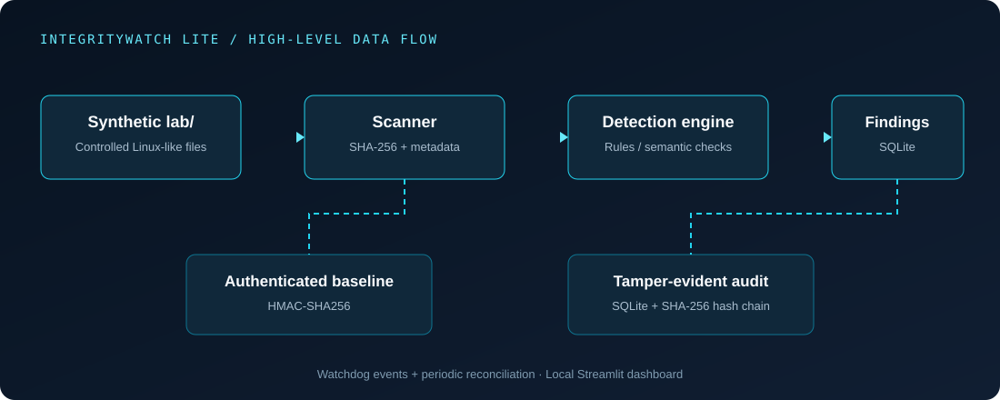

<!--
  TRILOCHAN PRABAKAR
  Personal GitHub profile
-->

  

  

    
    
  

  <h3>Cybersecurity student · Security engineering · Digital forensics</h3>
  
<i>Building practical tools. Understanding systems. Learning by doing.</i>

---

<table>
  <tr>
    <td width="62%" valign="top">
      <h2>About</h2>
      I'm Trilochan, a B.Tech Cybersecurity student at Amrita Vishwa Vidyapeetham. I'm interested in understanding systems at a deeper level, investigating security-relevant activity, and developing practical defensive tools.
        
      My focus is on learning the fundamentals and applying them through hands-on projects, labs, and experimentation.
    </td>
    <td width="38%" valign="top">
      <h2>Focus</h2>
      
▸ Security engineering

      
▸ Linux &amp; system security

      
▸ Digital &amp; memory forensics

      
▸ Network security

      
▸ Incident response

    </td>
  </tr>
</table>

## Technical toolkit

  

| Area | Tools and technologies |
|:--|:--|
| Programming | Python, C, Bash |
| Operating systems | Linux, Windows |
| Networking | TCP/IP, Wireshark, Cisco Packet Tracer |
| Development | Git, GitHub, VS Code |
| Security | File integrity monitoring, system security, digital forensics, incident response |

---

## Featured project

<table>
  <tr>
    <td valign="top" width="58%">
      <h3><a href="https://github.com/trilochan-prabakar/IntegrityWatch-Lite">IntegrityWatch Lite</a></h3>
      
<b>Explainable file integrity monitoring</b>

      
A local-first security tool that monitors a controlled Linux-like lab, detects file changes, explains supported security-relevant modifications through explicit rules, and maintains tamper-evident audit history.

      

        
        
        
      

      
<a href="https://github.com/trilochan-prabakar/IntegrityWatch-Lite">Explore repository →</a>

    </td>
    <td valign="top" width="42%">
      
    </td>
  </tr>
</table>

**What it demonstrates**

- SHA-256 baselines and file metadata comparison
- Semantic checks for selected Linux configuration files
- Rule-based findings with severity and MITRE ATT&amp;CK references
- HMAC-authenticated baseline
- SQLite findings with a SHA-256 hash-chained audit log
- Filesystem event monitoring with periodic reconciliation
- Local Streamlit dashboard and repeatable evaluation

Designed for controlled, local evaluation of a synthetic lab — not presented as enterprise endpoint protection.

---

## Current learning

  <table>
    <tr>
      <td align="center" width="25%"><b>01</b> Linux internals System behaviour</td>
      <td align="center" width="25%"><b>02</b> Memory forensics Evidence analysis</td>
      <td align="center" width="25%"><b>03</b> Incident response Detection &amp; triage</td>
      <td align="center" width="25%"><b>04</b> Network analysis Traffic investigation</td>
    </tr>
  </table>

## GitHub activity

  
  
    
  

---

  <h3>Let's connect</h3>
  
    
  Curious by nature. Practical by approach.

