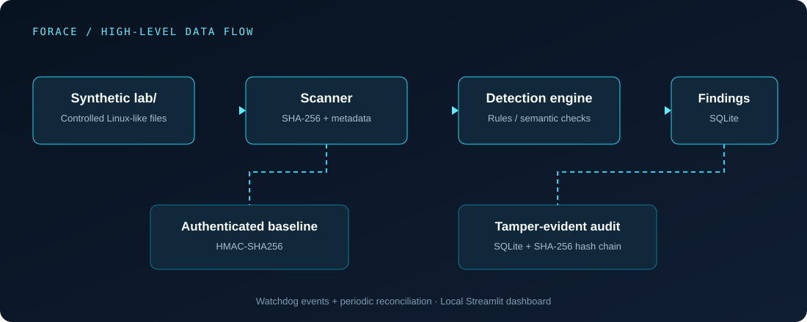

  

  <h2>Building practical tools. Understanding how systems fail.</h2>
  
B.Tech Cybersecurity student at <strong>Amrita Vishwa Vidyapeetham</strong> Focused on Python development, backend systems, security engineering and digital forensics.

  
  

---

## About

I'm a cybersecurity student who enjoys understanding what happens beneath the surface of software and systems: how services make authorization decisions, how files and events can reveal suspicious activity, and how digital evidence can be preserved and interpreted.

I learn by building, testing and documenting practical tools. I care about the engineering behind a result—clear requirements, reproducible experiments, meaningful automated tests and honest validation boundaries.

**Areas I’m focused on**
- Python development and backend systems
- Security engineering and defensive tooling
- Linux and operating-system security
- Digital forensics and memory forensics
- Network security and incident response

## Featured projects

### REMNANT — V3.0.0
**HTTP Cache Authorization & Identity-Isolation Security Testing Framework**

REMNANT investigates whether HTTP caching can violate authorization boundaries. It began with a controlled grant → cache → revoke → replay experiment and now includes a separate V3 HTTP scenario runner for cache behavior and cross-identity isolation testing.

**What I built**
- V1/V2 authorization replay experiment with Redis-backed response caching and a strict three-condition finding oracle.
- FastAPI protected-origin adapters, explicit cache observations and versioned metadata.
- Differential response diagnostics, tenant-aware policy testing, SQLite evidence, and JSON / standalone HTML reports.
- V3 YAML-driven HTTP scenarios with separate origin and proxy clients.
- HTTP cache diagnostics covering cacheability, freshness, Cache-Control, Expires, Vary, Set-Cookie and observed cache states.
- Cross-identity isolation detection using strict authorization, proxy response, cache-hit and foreign-canary conditions.
- Body-free V3 SQLite evidence, run comparison, bounded concurrency for read-only scenarios, and a Varnish 7.6 integration fixture.

V3.0.0 published November 26, 2026. Post-merge full-suite and V3/Varnish GitHub Actions workflows passed. Python 3.12 · FastAPI · HTTPX · Redis 7 · SQLite · pytest · Varnish 7.6. MIT License.

> Scope: a controlled research and testing harness—not a general-purpose vulnerability scanner or production authorization system. A negative result does not prove a target is free of cache-related authorization flaws.

---

### FORACE — V2.0.0
**Explainable file-integrity monitoring and evidence history for a controlled Linux-like lab**

FORACE monitors a synthetic Linux-like lab, detects file and selected metadata changes, explains supported security-relevant modifications through explicit rules, and records findings in a tamper-evident audit history. V2 strengthens scan reliability and evidence provenance by recording per-file observations, linking findings to scans, and verifying observation manifests against the audit chain.

**What I built**
- SHA-256 file observations and HMAC-SHA256 authenticated baselines.
- Rule-based semantic checks R01–R12 with severity levels and MITRE ATT&CK references.
- Watchdog filesystem events backed by periodic full reconciliation.
- SQLite findings linked to originating scans through `scan_id`, with atomic scan/finding/audit persistence.
- Per-file observation history, explicit completed / completed-with-errors / failed scan states, and audit-linked manifest verification.
- CLI commands for scan history and evidence verification, plus a read-only Streamlit investigation dashboard.
- Isolated synthetic attack and benign evaluations, with reproducible reports.

**Evaluation on the 30-scenario synthetic corpus:** smart mode detected 20/20 simulated attack scenarios with alerts on 0/10 benign scenarios. Hash-only comparison detected 18/20 attack scenarios and alerted on 9/10 benign scenarios. These are controlled corpus results, not real-world detection rates.

V2.0.0 published November 27, 2026. Validation: 225 automated tests passed in CI on Python 3.11 and 3.12. Python · Watchdog · PyYAML · SQLite · Streamlit · pandas · pytest. MIT License.

> Scope: a local, single-user teaching and evaluation tool for a synthetic lab—not enterprise endpoint protection. File observations are point-in-time; the local audit chain is tamper-evident, not immutable against an attacker able to rewrite the database.

---

### VERITY
**Forensic timestamp normalization and interval comparison**

VERITY is a Python library and CLI that decodes selected forensic timestamps, normalizes them into closed UTC intervals, and compares event intervals using weak precedence. It preserves source inputs and requires explicit metadata rather than guessing timezones.

**What I built**
- Timestamp decoding for APFS, NTFS FILETIME, exFAT and Discord Snowflake values.
- Closed-interval normalization using integer nanoseconds.
- Pairwise event comparison with explicit handling of overlapping or undetermined intervals.
- CSV-based input, normalized output and comparison reports.
- Validation and explanations for unresolved or invalid timestamp records.

Validation: 55 tests passed locally with 88% coverage; GitHub Actions CI passed on Python 3.10, 3.11, 3.12 and 3.13, with per-version coverage artifacts. Python · dfDateTime · pytest. Based on the timestamp model by Hornung et al., TIME 2026.

---

### Dynamic QoS-Aware SDN
**Controller-driven path selection and failover in a Mininet diamond topology**

A Computer Networks group assignment that I helped refine through controller hardening, regression tests and Mininet runtime validation. The Ryu controller uses OpenFlow 1.3, port-statistics-based utilization estimates and a strict reroute threshold to respond to congestion and link failure. Original group-project attribution is retained in the repository.

Validation: 31 automated tests passed; congestion rerouting, link failover/recovery and end-to-end connectivity were exercised in the documented virtual lab. Configured delay/loss/jitter profiles are not live measurements.

## Technical toolkit

| Area | Technologies and concepts |
|:--|:--|
| **Programming** | Python · C · Bash |
| **Backend & testing** | FastAPI · HTTPX · pytest · REST APIs |
| **Data & infrastructure** | Redis · SQLite · Docker |
| **Systems** | Linux · Windows · WSL2 |
| **Networking** | TCP/IP · Wireshark · Cisco Packet Tracer · Mininet · OpenFlow |
| **Security** | Authorization testing · Integrity monitoring · Digital forensics · Incident response |
| **Developer tools** | Git · GitHub · VS Code |

## What I’m learning now
- Strengthening Python, software engineering and backend development fundamentals.
- Deepening Linux, operating-system and networking knowledge.
- Exploring memory forensics and incident-response workflows.
- Building focused projects and documenting the engineering behind them.

## GitHub activity

A snapshot of my public GitHub activity and most-used languages. These cards are generated dynamically and may take a moment to load.

  
  

## Find me

  
  
  

---

<strong>Interested in practical cybersecurity, thoughtful engineering and learning by building.</strong>

