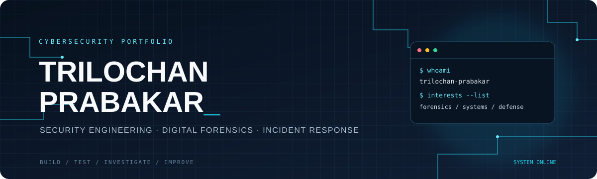

  

  <h2>Building practical tools. Understanding how systems fail.</h2>
  

    B.Tech Cybersecurity student at <strong>Amrita Vishwa Vidyapeetham</strong> 
    Interested in security engineering, Linux systems, digital forensics and incident response.
  

  
  
  

---

## About

I'm a cybersecurity student who enjoys understanding what happens beneath the surface of a system: how files and services behave, how suspicious changes can be identified, and how digital evidence can be preserved.

I learn by building, testing and documenting practical security tools. I care about understanding the engineering behind a result—not just making a demo work.

**Areas I'm focused on**
- Security engineering and defensive tooling
- Linux and operating-system security
- Digital forensics and memory forensics
- Network security and traffic analysis
- Incident response and investigation workflows

## Featured project

### IntegrityWatch Lite
**Explainable file-integrity monitoring for a controlled Linux-like lab**

IntegrityWatch Lite monitors a synthetic Linux-like lab, detects file and selected metadata changes, explains supported security-relevant modifications through explicit rules, and records findings in a tamper-evident audit history.

  

**What I built**
- SHA-256 file baselines with HMAC-SHA256 baseline authentication.
- Rule-based semantic checks with severity levels and MITRE ATT&CK references.
- Watchdog filesystem events backed by periodic full reconciliation.
- SQLite findings and a sequential SHA-256 hash-chained audit log.
- Local Streamlit dashboard and repeatable smart-mode vs hash-only evaluation.

**Evaluation on the authored synthetic test corpus:** smart mode detected 12/12 expected attack rules with 0/4 benign false-positive scenarios. Hash-only mode detected 11/12 attack scenarios and raised 3/4 benign alerts. These are controlled test-corpus results, not real-world detection rates.

Scope: a local, single-user teaching and evaluation tool for a synthetic lab—not enterprise endpoint protection. The repository includes the threat model, limitations, setup instructions and reproducible tests.

## Technical toolkit

  

| Area | Technologies and concepts |
|:--|:--|
| **Programming** | Python · C · Bash |
| **Systems** | Linux · Windows · WSL2 |
| **Networking** | TCP/IP · Wireshark · Cisco Packet Tracer |
| **Developer tools** | Git · GitHub · VS Code |
| **Security** | Integrity monitoring · System security · Digital forensics · Incident response |

## What I'm learning now

- Strengthening Linux, operating-system and networking fundamentals.
- Exploring memory forensics and incident-response workflows.
- Practising security investigation and traffic analysis.
- Building focused projects and documenting the engineering behind them.

## GitHub activity

  
  
   
  

---

  **Interested in practical cybersecurity, thoughtful engineering and learning by building.**
   
  <a href="https://trilochan-prabakar.github.io/trilochan-prabakar/">Portfolio</a>
  &nbsp;·&nbsp;
  <a href="https://www.linkedin.com/in/trilochan-prabakar-baa17a408/">LinkedIn</a>
  &nbsp;·&nbsp;
  <a href="mailto:trilopraba@gmail.com">Email</a>

